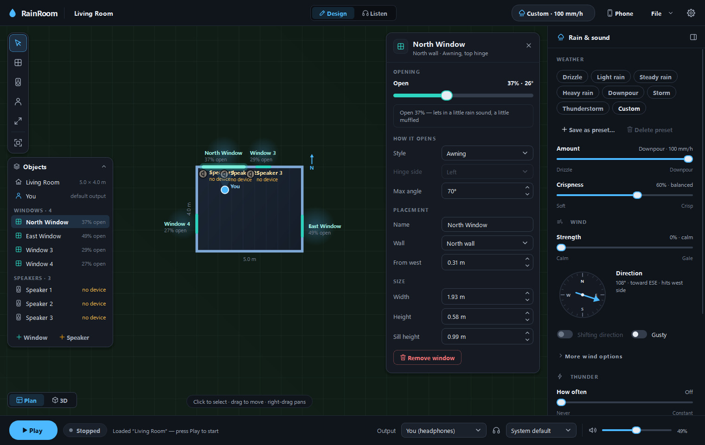
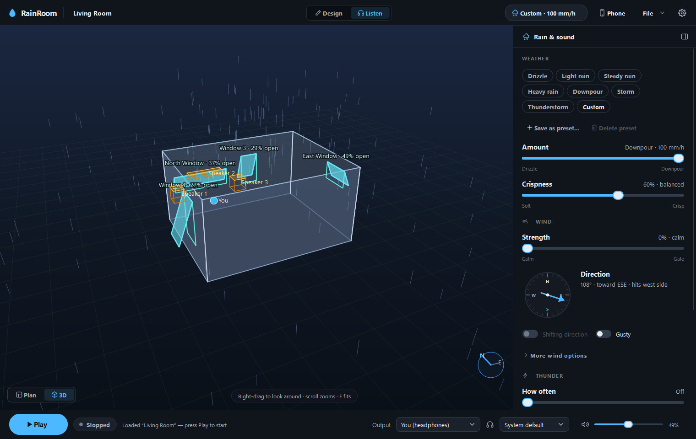
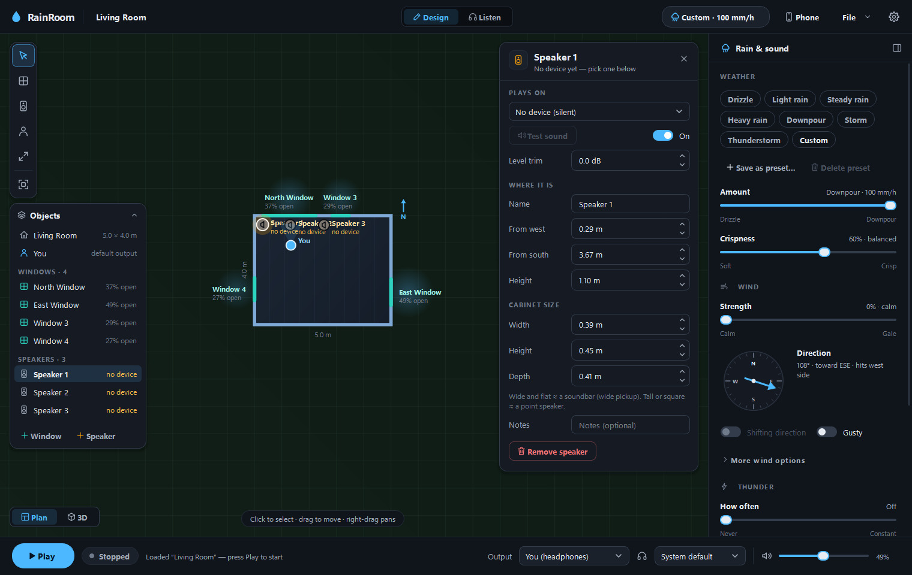

# RainRoom3D

**Build your room, open the windows, and hear the rain outside — in 3D, on headphones or on your real speakers.**

[](https://github.com/Stelliro/RainRoom3D/releases/latest)
[](LICENSE)
[](#download)
[](requirements.txt)

<p align="center">
  
</p>

RainRoom3D simulates a rainstorm around a house you draw. Rain lands on the
roof, the walls, the windows and the yard. What you hear depends on:

- what the house is made of;
- which windows are open, and how far;
- where the wind comes from;
- where you sit.

The sound comes from a physical model, not a looped recording. A tin roof
rattles, a brick house stays quiet, and opening a window lets the yard in.

> **1.0 is the first full release.** RainRoom3D is still a work in progress at
> heart. Expect small improvements and sound tuning in point releases from here.

---

## Download

**Windows:**

1. Download `RainRoom3D-<version>-windows-portable.zip` from the [latest release](https://github.com/Stelliro/RainRoom3D/releases/latest).
2. Unzip it anywhere and run **`RainRoom3D.exe`**.

Nothing is installed. To remove it, delete the folder.

The exe isn't code-signed, so Windows SmartScreen may say *"Windows protected
your PC"* the first time. Choose **More info → Run anyway**.

Prefer to run from source? See [Run from source](#run-from-source).

---

## What it does

**Design the house**
- Draw the house on outdoor ground: width, depth, ceiling height and yard size.
- Pick a **roof** (tin, metal, tile, shingle, wood or glass) and **walls** (brick, wood, glass or tin), and set how thick they are.
- Add **windows** on any wall. Set their size, sill height, how they open (awning, casement, hopper, slider and more) and how far.
- Place **You** (the listener) and any number of **speakers**. Connect each speaker to a real output device.
- Work in the **floor plan** or the **3D view**. A live inspector shows whatever you click.

**Hear the weather**
- **Rain** from a light drizzle to a 100 mm/h downpour, with real drop sizes. Every drop has its own position, so you hear where it lands.
- **Wind** with direction, natural gusts and an option for shifting direction:
  - it pushes the rain onto the walls facing it;
  - it whistles past the eaves;
  - it blows in through open windows, while shut windows and thick walls keep it out.
- **Thunder and lightning** from storms around the house: distant rumbles, close cracks, and flashes in the 3D view that light up the room.
- **Drips and gutters** that keep running after the rain stops.
- **Weather presets** from *Drizzle* to *Thunderstorm*.
- A full **sound mix** (wash, drops, room echo and wind) to adjust to taste.

**Listen your way**
- **You (headphones):** binaural 3D sound from where you sit in the room.
- **Speakers:** each mapped speaker plays what reaches its spot in the room. Speakers can be spread across several output devices at once.
- **Phone:** scan a QR code to play the rain on your phone over Wi-Fi. Each phone gets its own room under the same sky.

**Keep your rooms**
- Your room **saves itself** and is waiting when you come back.
- **Save as preset…** keeps a whole house: its shape, materials, windows, speakers and every sound setting. Opening the preset brings it back exactly as saved.
- **File → Back to your previous room** undoes opening another house.
- Four example houses to start from: a tin shed, a tile cottage, a brick house and a glass studio.

<p align="center">
  
  &nbsp;
  
</p>

---

## First listen

1. Start RainRoom3D. It opens on the **Living Room** house, or on your own room once you've made one.
2. Click a window and drag **Open** to let some rain in.
3. Pick a weather preset in **Rain & sound**. Try *Steady rain*, then *Thunderstorm*.
4. Set **Output** to **You (headphones)**, put headphones on and press **Play**.

**Design** mode is for building the house. **Listen** mode shows the 3D view
and the weather. Hover over any control to see what it does.

---

## Run from source

**Needs:** Windows, Python 3.10 or newer (developed on 3.14), and a sound output.

```powershell
git clone https://github.com/Stelliro/RainRoom3D.git
cd RainRoom3D
python -m pip install -r requirements.txt
python -m app.main
```

Or double-click **`run.bat`**. The first time, it sets up a `.venv` with the
requirements; after that it starts the app directly.

`run.sh` does the same on Linux and macOS. Those platforms aren't supported
yet, but the app may run.

Your room is kept in `configs/my_house.json` and your presets in
`configs/presets/`. Both stay on your PC and are never added to git.

---

## Project layout

For what each module does and how the sound engine fits together, see the
**[codebase index](docs/CODEBASE.md)**.

```text
app/
  audio/       the sound: rain, house model, wind, thunder, spatial rendering
  graphics/    the 3D view and lightning
  models/      house, materials, presets, settings
  remote/      the phone app (LAN server + web app)
  ui/studio/   the desktop app window
  tools/       test suites and helper scripts
assets/        rain samples and the app icon
configs/       the default house and the example houses
docs/          the codebase index and README screenshots
scripts/       release build, source zip, screenshots, sample generation
```

**Tests:**

```powershell
python -m app.tools.test_rain_spatial
python -m app.tools.test_settings
python -m app.tools.test_remote
python -m app.tools.test_ui_smoke
```

**Release build:** this script makes a portable Windows folder and zip. It
leaves out CUDA and machine-learning packages a developer's Python may have
installed, which keeps the build small.

```powershell
powershell -ExecutionPolicy Bypass -File scripts/build_release.ps1
# → dist/RainRoom3D/RainRoom3D.exe
# → dist/RainRoom3D-<version>-windows-portable.zip
```

The version number lives in `app/version.py`. To retake the screenshots in
this README, run `python scripts/capture_screenshots.py`.

---

## Changelog

See **[CHANGELOG.md](CHANGELOG.md)**.

## License

[PolyForm Noncommercial License 1.0.0](LICENSE). Copyright (c) 2026 Stelliro.

You may use RainRoom3D for personal and other noncommercial purposes. **Commercial use is not allowed.**

## Feedback

Bug reports, ideas and "the rain sounds wrong when…" reports are welcome in
[Issues](https://github.com/Stelliro/RainRoom3D/issues).

Please say which house, weather and output you used. A short recording helps a lot.
